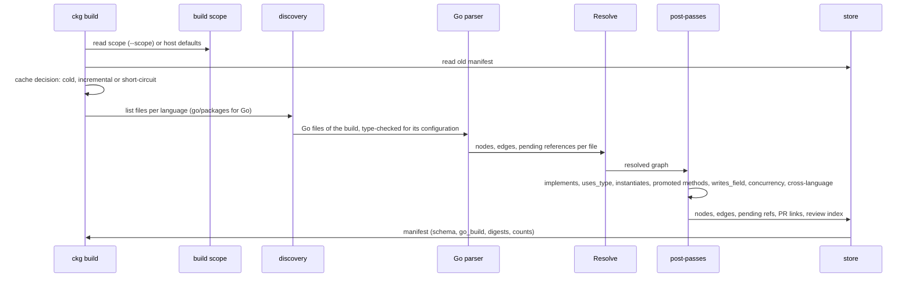

# Graph build and query flow, with logging (design)

Status: 2026-11-16. How source becomes a graph and how a query walks it, the points where a run must leave a log
record for debugging, the log levels for development and operation, and where logs are written. The build stages are
those of `internal/graph/buildpipe` today; the contract they move to is
[the shared symbol contract](./SYMBOL-CONTRACT-DESIGN.md). User decision 2026-11-16: logs go to per-run files next to
the graph, with readable text on stderr; central collection is added with the server mode of decision D10.

## 1. Why

Defects so far were silent. Two Go packages named `bn256` got one node id and the store's `INSERT OR REPLACE`
(`internal/graph/persist/sqlite_writer.go`) kept one node without a word; `Resolve` drops every reference it cannot
bind (`internal/graph/parse/golang/resolve.go`) and the manifest field `unresolved_refs_count` is never set. Both were
found only by building a separate verifier. Today the build logs counts per stage ("detected files", "built N
nodes"), the graph MCP tools log nothing per request, and only the search composer has a per-stage trace
(`CKS_DEBUG_TRACE`, a JSONL file). The logs below make such defects visible in the run that causes them.

## 2. Build flow



| Stage | Code | Input | Output |
|---|---|---|---|
| Scope | `cmd/graph/scope.go` | scope JSON | Go build configuration, file filter |
| Cache decision | `buildpipe/pipeline.go`, `buildpipe/cache.go` | old manifest, discovery | cold, incremental or short-circuit |
| Discovery | `internal/graph/detect` | source root, configuration | files per language |
| Parse (pass 1) | `buildpipe/language_runners.go`, `internal/graph/parse/golang` | files, go/packages | nodes, edges, pending refs |
| Resolve (pass 2) | `parse/golang/resolve.go` | pending refs | edges between nodes |
| Post-passes | `parse/golang` (`implements.go`, `uses_type.go`, `instantiates.go`, `promoted.go`, ...) | packages, nodes | more edges and nodes |
| Contract records | `buildpipe/contract_records.go`, `parse/golang/contract.go` | Go resolved graph | `Decl`, `Ref` records and the graph rebuilt from them |
| Validate | `buildpipe/pipeline.go` (`validateAndSanitize`) | graph | graph without dangling edges |
| Persist | `internal/graph/persist` | graph | `graph.db`, manifest |
| Verify (separate run) | `internal/graph/verify` | graph, source, configuration | report |

## 3. Query flow

```mermaid
sequenceDiagram
  participant C as MCP client (agent)
  participant M as ckg mcp or cks
  participant Q as query handler
  participant S as store
  C->>M: tool call (request id, arguments)
  M->>Q: resolve the start symbol (exact id, or short name with candidates)
  Q->>S: walk edges hop by hop with filters (edge kind, layer, configuration)
  S-->>Q: nodes and edges per hop
  Q-->>M: compact structure first; bodies only on request
  M-->>C: result
```

The graph tools are registered in `pkg/graph/mcphandlers/registerall.go`; the search composer of CKS calls the
graph through `internal/system/ckgclient`. The root-cause walk of decision D14 is a further handler on the same path.

## 4. Log points

Levels: `ERROR`, `WARN`, `INFO` (operation default), `DEBUG` (development), `TRACE` (development, file only; per item).

| Point | INFO | DEBUG | TRACE |
|---|---|---|---|
| Scope | configuration id, GOOS/GOARCH/cgo/tags, file counts by role | excluded files | — |
| Cache decision | path taken and why (schema, version, build configuration, files changed) | changed and removed files | — |
| Discovery | files per language, after the filter | files the filter dropped | — |
| Type loading | packages reached, packages with errors, errors by kind, seconds; with a scope, its outside modules matched, at another version, from another directory, not loaded (`WARN` with the first N errors when there are errors or other versions) | modules from another directory or not loaded | — |
| Parse | files parsed, failures, seconds | failed files and errors | — |
| Resolve | references resolved, unresolved by reason (outside the build, dynamic, no node) | first N unresolved per reason | every reference and its target |
| Duplicate node ids | `WARN`: how many ids were produced twice, with the first N pairs (qualified name, file) | — | — |
| Post-passes | edges added per pass, seconds | — | — |
| Contract records | declarations, test declarations, references, seconds | — | — |
| Validate | dangling edges dropped (`WARN` when not zero) | first N dropped edges | — |
| Persist | nodes, edges, seconds | — | — |
| MCP request | request id, tool, result size, seconds, error | sanitized arguments, start-symbol resolution | nodes visited with cost |
| Search composer | candidates per stage, seconds | — | per-candidate scores (today's `CKS_DEBUG_TRACE`) |

Rules:

- **Count in loops, log at stage end.** A go-stablenet build has more than two million edges; a record per edge would
  cost more than the build. Loops increment counters; one summary record ends each stage.
- **Samples are bounded.** Examples are the first N (default 20) per category.
- **No work when disabled.** Records are built only after the level check (`slog` `Enabled`, `LogAttrs`).
- **No source text.** Records carry file and line, never bodies, so code that holds secrets does not leak into logs.
- **One request id.** A request that goes from CKS to ckg and ckv carries one id through all three engines.

## 5. Levels by area

`CKG_LOG_LEVEL` (and `CKV_LOG_LEVEL`, and a CKS equivalent) takes a default level and per-area overrides, for example
`CKG_LOG_LEVEL=info,resolve=debug,mcp=trace`. Areas: `scope`, `cache`, `discovery`, `load`, `parse`, `resolve`,
`contract`, `graph`, `passes`, `persist`, `mcp`, `compose`. `--verbose` stays a shortcut for `debug` everywhere.

| Mode | Default | Where |
|---|---|---|
| Operation | `INFO`, JSON | per-run file plus text on stderr |
| Development | `DEBUG` for the area being debugged, `TRACE` only to the file | same files |

## 6. Where logs go (user decision A)

| Run | File | Rotation |
|---|---|---|
| `ckg build` | `<graph dir>/logs/build-<UTC time>.jsonl` | one file per run; the newest 20 kept |
| `ckg mcp`, `cks` server | `<user cache dir>/knowledge-system/logs/mcp-<UTC date>.jsonl` (macOS `~/Library/Caches`, Linux `~/.cache`) | daily file |
| any | stderr: readable text | — |

Servers do not write into the graph directory: they open graphs read-only, and a graph directory can be a published
dataset, so a server's log goes to the user cache directory instead (an adjustment of decision A for servers).
`--log-file` keeps working and overrides the default path. stdio MCP servers write nothing but protocol messages to
stdout, so logs never go there. Central collection (OpenTelemetry to a log store) is added with the server mode of
decision D10; JSON lines keep that move cheap.

## 7. Order of work

1. Per-area levels and the default per-run log files. Done for ckg (2026-11-16): `internal/logx` (`ParseLevels`,
   `NewHandler`, `LevelTrace`, `RunLogFile`, `DailyLogFile`), `ckg build` writes `<out>/logs/build-<time>.jsonl`,
   `ckg mcp` writes a daily file in the user cache directory; ckv and cks follow.
2. Build summaries: resolve counts by reason, duplicate node ids, dropped edges, cache decision reason. Done
   (2026-11-16) for the first three: `resolve summary` (area `resolve`) with `unresolved_<reason>` counts and DEBUG
   samples, the manifest's `unresolved_refs_count`, `duplicate node ids` (area `graph`, WARN, checked before
   `graph.Build` because that is where a repeated id keeps one node), and `cache decision` (area `cache`) with the path
   and its reason. On go-stablenet 6e41d966 (`gstable-linux-amd64`) the first build with them reported 46,199 dropped Go
   references (outside the graph 26,864, no target 19,127, bare name 208) and one duplicate node id, which was a
   defect: a package-level `var testBlockchainsLock sync.Mutex` got a Variable and a Mutex node with one id. Mutex
   node ids now carry the node kind (schema 1.26) and the warning is gone.
3. Type loading. Done (2026-11-16): `go packages loaded` (area `load`) after go/packages loads the Go packages,
   cold and incremental, and the manifest's `go_load_errors_count`. `ckg verify` reports the same for the truth's load
   (`load` in the report), because graph and truth come from the same go command: a package it cannot load is
   missing from both, and the comparison agrees. On go-stablenet 6e41d966 with an empty module cache the build lost
   every outside module (4,719 errors, 3,726 instead of 208 bare-name references) and `ckg verify` still reported 0
   misresolved and 0 unexpected edges; the load record and the report's `load` now show it. With the scope's module
   cache, `gstable-linux-amd64` built on macOS arm64 has 19 errors in 10 packages: cgo cannot run for linux/amd64 on
   this host, so packages that import `C` (`crypto/secp256k1` of the repository, `net`, `os/user`, pebble, zstd,
   blst, usb) are type-checked without it; `darwin/arm64` has one (`golang.org/x/tools/internal/tokeninternal`, an
   old x/tools that refuses newer Go releases).
4. MCP request records with a request id in `ckg mcp`; the same id passed through CKS.
5. Keep this page and the code in step: a stage that changes updates its row here.
