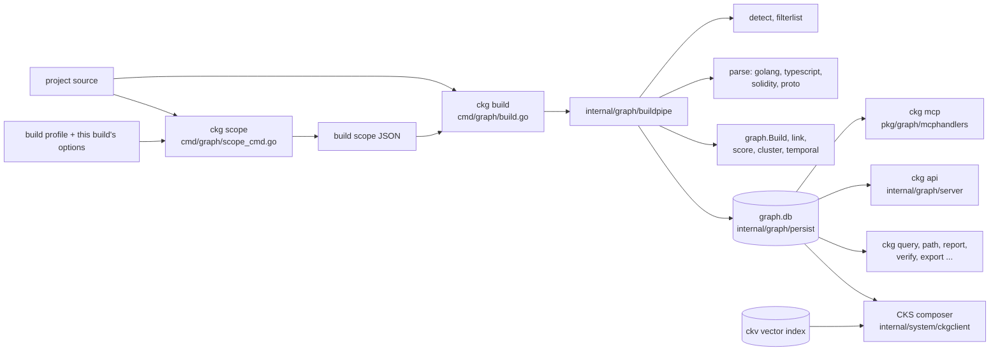
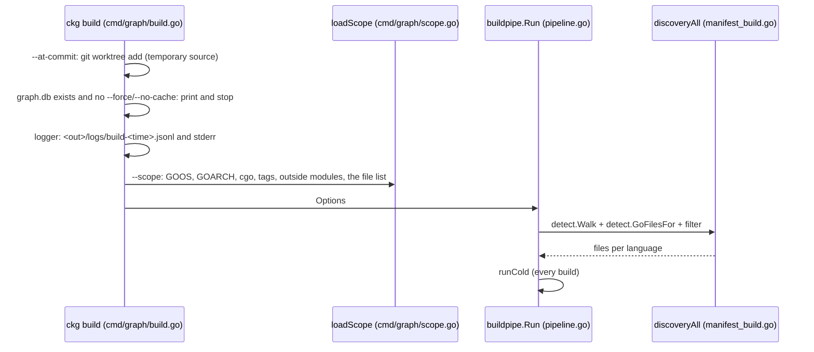
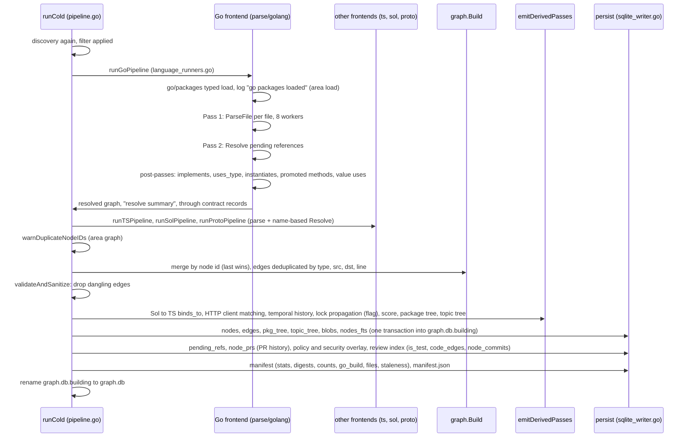
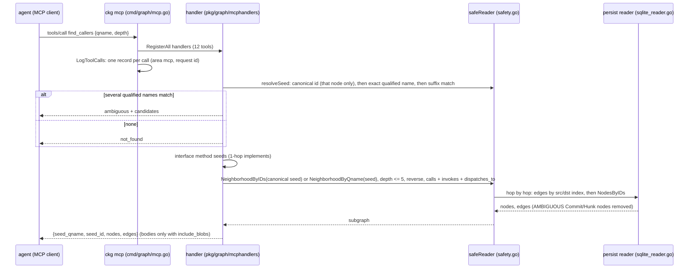
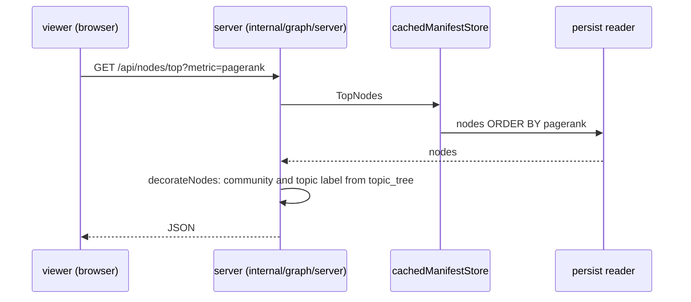
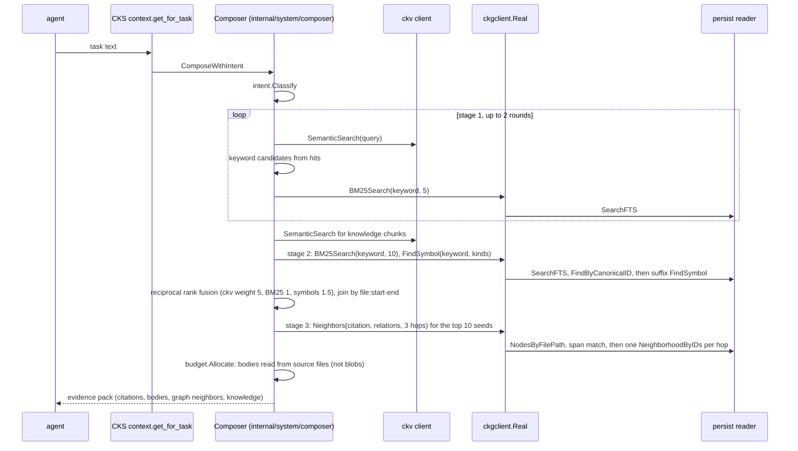

# ckg structure: from project source to graph.db, and every way it is queried

Status: 2026-11-16, code at main 9b8d456d; section 8 records the fixes made after the first version of this page. A map of the code graph engine (ckg) as it is, with sequence diagrams:
how `ckg build` turns a project's source into `graph.db`, what each stored table holds and who writes it, and every
surface that reads the graph (`ckg mcp`, `ckg api`, the CLI, and the CKS search composer). The design the engine
moves to is [the shared symbol contract](./SYMBOL-CONTRACT-DESIGN.md); logging and the short flow summary are in
[the build and query flow](./BUILD-AND-QUERY-FLOW.md). Section 8 lists defects found while mapping; each is marked
as read in the code or inferred.

## 1. Components



Every reader opens the database read-only (`persist.OpenReadOnly`, `mode=ro&immutable=1`); CKS opens it in its own
process through `ckgclient.NewReal`, not over MCP or HTTP.

### 1.1 Where the build scope JSON comes from

The scope is extracted before the graph is built, every time, from the options the build at hand uses; the graph
then reads exactly the files the scope lists. Without a scope every file of the tree is read.

```
ckg scope --src <go-stablenet> --profile projects/stablenet/filelist.yaml \
  [--goos linux --goarch amd64 --cgo 1 --tags urfave_cli_no_docs,ckzg] [--binary build/bin/gstable] \
  --out <dataset>/build-scope.json
ckg build --src <go-stablenet> --scope <dataset>/build-scope.json --out <graph dir> --no-cache
```

The profile (`projects/<pack>/filelist.yaml`) holds the project's usual build: `build_context` (goos, goarch, cgo,
tags), `build_roots` (the entry packages), `include_package_tests`, `inclusions` and `exclude_globs`; unknown keys are
an error. A flag given to `ckg scope` overrides the profile for that run (`--tags`, even empty, replaces the tags;
`--entry` replaces the roots; `--include` adds globs as the inclusion `command-line`), so a build with other options
gets the scope of that build. `cmd/buildscope` runs the same extraction (`internal/buildscope.ExtractProject`).

`inclusions` is the one place for exceptions: code the build does not compile that belongs to the scope because the
compiled code cannot be understood without it, such as the system contracts of an EVM chain. Each entry has an `id`,
a `reason`, `files` (globs) or `go_packages` (main-module patterns whose own files are added), an optional `exclude`,
and an optional `linked_by.embed`, globs of files the build must embed:

```yaml
inclusions:
  - id: system-contracts
    reason: genesis contracts; contracts.go embeds their bytecode and the Go code calls them by address
    files: ["systemcontracts/**/*.sol"]
    linked_by: {embed: ["systemcontracts/artifacts/v1/*"]}
  - id: system-contract-tooling
    reason: their end-to-end tests and the solc tooling; no shipped binary imports them
    go_packages: [./systemcontracts/test, ./systemcontracts/compile/...]
```

Extraction fails when an inclusion has no id or reason, when one of its globs matches no file, when it adds nothing
the build does not already have, and when the build no longer embeds a file its `linked_by` names, so an exception
cannot outlive its reason unnoticed. An inclusion without `linked_by` rests on its reason alone. Every file an
inclusion adds carries its id as `included_by`; the scope lists each inclusion with its reason, file count and link,
and the files the build embeds as `embed_files`. The older `extra_packages` and `extra_globs` keys still work as the
inclusions of those names, without a reason and without the match check. `cks filelist` refuses a profile with
`inclusions`.

The go command decides the Go files: `ExtractGo` runs it with the effective `GOOS`, `GOARCH`, `CGO_ENABLED` and tags
(`GOWORK=off`): `go env` for the target, `go version` and a sha256 of the go binary for the toolchain, `go list -e
-deps -json <entry points>` for the build and `go list -e -json <extra packages>` for the packages the profile adds.
Every main-module package gives its `GoFiles`, `CgoFiles` and `SFiles` (role production), its `TestGoFiles` and
`XTestGoFiles` (role test, unless the profile turns tests off), its `IgnoredGoFiles` and, for the build, its
`EmbedFiles`; every other module becomes an outside module. The inclusions then add their files, and `exclude_globs`
remove files from the whole scope. With the options go-stablenet's Makefile target gstable uses, this list is exactly the set of main-module files the compiler
receives: 673 of 673 on darwin/arm64 (recorded with `-toolexec`) and 675 of 675 on linux/amd64 (`go build -n`).

The extraction fails instead of writing a doubtful scope: when the go command reports load errors (a missing module
leaves packages out; `--allow-problems` keeps the scope anyway) and when a `--binary` was built with other options.
The binary check reads `go version -m` and compares its `GOOS`, `GOARCH`, `CGO_ENABLED`, the set of `-tags` and its
main package with the scope's target and entry points. The scope records the profile's sha256 and every binary that
matched.

`ckg build --scope` reads only the files the scope lists, of every language, type-checks the Go files with the
scope's target and compares the loaded modules with the scope's. `cks setup` with a `filelist:` profile runs `ckg
scope` as its first step (`--build-goos`, `--build-goarch`, `--build-cgo`, `--build-tags`, `--build-binary` pass this
run's options) and gives the scope to `ckg build --scope` and `ckv build --files-from`; the options are part of the
dataset's input digest. `cks.ops.index` does the same when `backends.ckg.build_profile` is set. The scope records the
toolchain that made it, but the build does not check it.

The scope stops at the compiler. The linker keeps only the functions reachable from `main`: built with
`-ldflags=-dumpdep` and inlining off, gstable keeps 7,205 of the graph's 9,498 production functions and methods
(75.9%); the graph still holds the other 2,293. Files compiled into the binary without being Go source, such as the
22 `go:embed` files and the C sources cgo includes, are not listed either.

## 2. Build: entry



- Every build is cold (section 4). The graph an output directory already holds is not read.
- `--force` builds over an existing `graph.db`; `--no-cache` does the same and changes nothing else, and the build log
  says so. `--rebuild-metrics` had no effect and is deprecated.
- The manifest still lists every file with its sha256, cache key and parser version: what the graph was built from.

## 3. Cold build



### 3.1 The Go frontend


Node ids come from `parse.NodeID(language, file, qualified name, start byte)`; call sites find their enclosing
function by byte span. Resolve binds a typed reference only by its canonical id and counts what it drops
(`outside_graph`, `no_target`, `bare_name`, `no_match`). Since schema 1.36 a call, interface call or type use whose
target is outside the build (standard library, a module dependency) points at an `External` node instead of being
dropped: one node per symbol (`external.go`), shared by all users, with its package in `attrs.external` (import path,
package name, `std` or the module path, module version) and the go/types signature. Only a root package's own
symbols without a node (files outside the build scope) still count as `outside_graph`. On go-stablenet `0bf2f4d1`:
1,411 External nodes, 35,729 edges to them (calls 29,146, uses_type 5,542, invokes 1,041), `outside_graph` 31,253 to
453, build time unchanged (44 s). The TypeScript, Solidity and Proto frontends resolve by name
and count nothing yet.

### 3.2 Derived passes

| Pass | Code | Adds |
|---|---|---|
| Sol to TS link | `link.SolToTS` (`link/xlang.go`) | `binds_to` from a Solidity contract to a TS class of the same name (INFERRED) |
| HTTP client matching | `link.MatchHTTPClients` (`link/http_match.go`) | rewires client endpoint placeholders (AMBIGUOUS) to server endpoints |
| Temporal | `emitTemporalEdges` (`buildpipe/temporal.go`), `temporal/git.go`, `temporal_hunks.go` | Commit and Hunk nodes, `changed_in`, `blame`, `has_hunk`, `adjacent`, `modifies`, patch blobs; capped by `--temporal-depth` (10) and 200 commits for hunks |
| Lock propagation | `propagateLockedFieldAccess` (`lock_propagation.go`), `--lock-propagation`, cold only | `accessed_under_lock` across calls, depth 5 |
| Scores | `score.Compute` (`score/score.go`) | degrees, usage score, PageRank (0.85, 30 iterations, Commit and Hunk excluded) |
| Package tree | `cluster.BuildPkgTree` | directory and package hierarchy |
| Topic tree | `cluster.BuildTopicTree` | Leiden communities at gamma 0.5, 1.0, 2.0 (seed 42), named after the highest-PageRank member |

Each pass that adds edges is followed by `validateAndSanitize`.

## 4. Incremental build (removed)

The incremental build was removed; every `ckg build` is cold. Measured with ckg 81274130 on go-stablenet, 11 of 13
edits gave a graph different from a cold build of the same tree (up to 572 extra and 34 missing edges, mostly calls
from promoted copies and cross-file calls from unchanged files), a rename of 49 files ran past 900 s twice, and an
incremental build took 88-125 s where a cold one took 40-60 s. Two cold builds of one tree are identical.

`ckg watch` and `ckg bench-index`, which depended on it, refuse to run and say so; rebuild with `ckg build`.

## 5. Stored tables

| Table | Written by | Holds | Read by |
|---|---|---|---|
| `nodes` | `InsertNodes` (build, overlay); `RebuildReviewIndex` sets `is_test` | every node: id, type, names, canonical id, file, span, language, signature, doc, scores, confidence, sub kind, attributes, search tokens | every surface |
| `edges` | `InsertEdges` | relations: src, dst, type, file, line, count, confidence, dispatch kind | MCP traversals, impact, concurrency, evidence; HTTP `/api/edges`, impact; CLI query, path, report, verify, exports; CKS neighbors, subgraph, impact, review |
| `nodes_fts` | `RebuildFTS` | FTS5 over name, qualified name, signature, doc, search tokens | MCP `search_text`, `get_context_for_task`; HTTP `/api/search`; CKS BM25 search |
| `blobs` | `InsertBlobs` | source slice per node, gzip patch per Hunk | MCP bodies (`include_blobs`), evidence patches, value flow; HTTP `/api/blob`; exports; CKS value flow, review (not composer bodies) |
| `pending_refs` | `InsertPendingRefs` | Pass-1 references, kept for the removed incremental build | no reader |
| `pkg_tree` | `InsertPkgTree` | package hierarchy | HTTP `/api/hierarchy`, `/api/nodes?parent`; export-static |
| `topic_tree` | `InsertTopicTree` | Leiden communities and labels per resolution | HTTP hierarchy and community labels; report, quickstart, export-static |
| `node_prs` | `InsertNodePRs` (cold only) | pull requests whose merge touched a node | MCP `change_history`, `get_context_for_task` (recent PRs); CKS |
| `code_edges`, `node_commits` | `RebuildReviewIndex` | code relations between production nodes; node to commit | CKS `review_function` only |
| `manifest` | `SetManifest` | build metadata (schema, versions, go_build, digests, counts, files, staleness) | readers' snapshot checks, HTTP `/api/manifest`, report, exports |

### 5.1 What the stored tables hold on go-stablenet

Measured on a cold build of go-stablenet 6e41d966 with the linux/amd64 scope (191,860 nodes, 265,620 edges; the
source copy has no git history, so `node_prs`, `node_commits` and the Commit and Hunk nodes are empty). That scope
was schema 1, made without the tags go-stablenet's gstable target uses, and its build still walked the tree for Solidity,
TypeScript, JavaScript and Proto files; a scope from the stablenet profile lists only the Solidity sources its
`system-contracts` inclusion names, so the JavaScript findings below do not arise in it.

Consistent:

- No edge points at a missing node, and no two edges share type, source, destination and line.
- `nodes_fts` has one row per node; every `code_edges` row is also an `edges` row; every `pending_refs` source exists.
- Every Go statement node (CallSite, IfStmt, LoopStmt, ReturnStmt, SwitchStmt, Channel, Goroutine) is contained by
  the function whose byte span holds it.

Not connected, or connected only to its parent:

| What | Count | Why |
|---|---|---|
| nodes with no edge at all | 33 | JavaScript files (rpc and console test data, tracers) that define nothing the TS frontend captures |
| File nodes without a parent | 62 | Solidity and TypeScript files: those frontends emit no Package node |
| AwaitPoint nodes without a parent | 54 | the TS frontend links them to their function by `awaits` only |
| Package nodes | 139 | roots; packages are linked to their files, not to each other |
| Import nodes linked only to their file | 6,870 | an import names a package, but no edge goes from the Import node to that Package node, so package dependencies cannot be walked |
| Variables and Constants linked only to their file | 7,392 and 1,522 | measured before schema 1.29; since then value uses are edges (below) |
| Go functions and methods with no callee in the graph | 4,478 of 9,507 production ones | calls into the standard library and outside modules are counted (`outside_graph`), not stored |
| statement nodes | 96,149 call sites, all if, loop, return and switch nodes | leaves under their function; calls are lifted to the function, so a statement says where, not what |

Wrong:

- TypeScript and JavaScript declarations store the span of their name, not of their body (`runQuery` in
  `parse/typescript/declarations.go` reads the `@name` capture). Their blobs hold the name only, and none of the
  19,775 TS statement nodes lies inside its parent's span.
- In minified files (`graphql/internal/graphiql/graphiql.min.js`, 18,728 nodes) the TS frontend finds a call's
  function by name and line, which one-line files with names like `i` and `a` cannot tell apart: 4,485 call sites
  keep their own `calls` edge to an unrelated function. The three vendored `*.min.js` files hold 21,757 of the
  graph's 191,860 nodes.
- Before schema 1.29, `references` edges did not exist, yet `RelationReferences` maps to them in CKS
  (`planTraversal`), so intents that ask for references (feature, refactor, concurrency, security) got nothing from
  that relation. Since 1.29 (`parse/golang/value_access.go`) a Go function, or a package-level initializer, has
  `references` to each package-level variable and constant it uses (`dispatch_kind` read or write), `reads_field`
  and `writes_field` to each struct field (literal fields and promoted fields included); each edge carries the
  first use's line and the number of uses. Since 1.30 there is one edge per use line, as for `calls`, with `count`
  the uses on that line; before, 72,663 later use lines were dropped (41,365 `reads_field`, 18,298 `writes_field`,
  13,000 `references`). On go-stablenet at `0bf2f4d1b` that adds 39,895 edges (253,973 to
  293,868; graph.db 299 MB to 308 MB): 18,784 `reads_field`, 14,603 `writes_field` (3,762 before), 10,270
  `references`. CKS still maps only `RelationReferences` to `references`; field edges are not mapped.
- 1,507 self loops: 1,402 `invokes` placeholders for calls through function values, 73 recursive `calls`, and 32
  `timeout_path` or `cancellation_path` edges from a function to itself.
- Before schema 1.31 a call through an interface stopped at the interface method: the 3,793 `invokes` edges with
  `dispatch_kind=interface_method` on go-stablenet at `0bf2f4d1b` had no edge on to an implementation, and a call
  through a function value stopped at its own function. Since 1.31 (`parse/golang/dispatch.go`, decision D3) the Go
  frontend builds SSA and runs VTA and adds `dispatches_to` (confidence `INFERRED`): from an interface method to each
  implementation whose values reach one of its calls (1,697 edges; 3,715 of the 3,793 interface calls now reach an
  implementation), and from a function that calls a function value to the functions the value can hold, with the line
  (636 `func_value`, 1,026 `closure`, the latter pointing at the declaration that contains the literal). A
  type-hierarchy link would give 2,129 interface edges; 1,605 are shared, VTA drops 524 whose types never reach a
  call and adds 92 the `implements` edges miss. SSA is built for every package without errors of its own: the
  linux/amd64 cgo build fails to type-check `runtime/cgo` on macOS, and go/packages marks every package that imports
  it as ill-typed (362 of 469). The pass takes about 2 s of a 38 s build; graph.db grows by 0.5 MB; `ckg verify` is
  unchanged.
- Before schema 1.32 the statement nodes of a Go body (19,348 IfStmt, 4,555 LoopStmt, 414 SwitchStmt, 16,430
  ReturnStmt, 97,755 CallSite, 424 Goroutine on go-stablenet) had only a `contains` edge from their function, and
  sends and receives on a channel that was not a local `make` pointed at a placeholder `CallSite`. Since 1.32:
  - `parse/golang/statement_links.go` adds `site_calls` (a call site or goroutine to what it calls, 48,608),
    `cond_reads` (a condition to the fields, variables and constants it reads, 11,135), `cond_calls` (to the
    functions it calls, 6,859), `body_writes` (a statement to the values its then, else, loop body, case or goroutine
    writes outside any nested statement, 2,697) and `encloses` (a statement to the statements directly inside it,
    62,229). Example: `AnzeonTipEnv.SetCurrentBlock` writes `currentState` only in the branches of the `if` on line
    56, which lies in the then branch of the `if` on line 54, whose condition reads `currentBlock` and `Header.Root`.
  - `parse/golang/dispatch.go` follows each channel value in SSA back to its make site, field or package-level
    variable, through phis, conversions, local cells, closure bindings, parameters (to every caller's argument in
    the VTA call graph) and results; it adds `sends_to` and `recvs_from` with the line and confidence `INFERRED`,
    `dispatch_kind` make, field or global. On go-stablenet 2,043 of the 2,870 sends and receives reach a channel (1,388 edges: 879 to fields, 509 to make sites); the others come from values the pass does not follow, such as map and slice elements and interface method results. The pass-one
    edges stay. The SSA pass now includes every method of every named type and their function literals, which
    `ssautil.AllFunctions` leaves out when nothing reaches them.
  - Edges 325,745 to 458,661, graph.db 314 MB to 338 MB, build 38 s, peak memory unchanged.
  - Since 1.34: `flows_to` joins the names of one channel (a make site to the field or variable it is stored in, 452
    edges), channel origins follow cells a closure captures by reference (2,377 of 2,870 operations reach a channel),
    and `dispatches_to` of kind `type_hierarchy` (418 edges) adds the implementations go/types allows that the value
    flow did not link. Queries show the value-flow targets first: `find_callees` uses type-hierarchy targets only for
    an interface method without value-flow ones, `search_code` lines read "may run A, B; 3 more by type" (the
    type hierarchy's names only when the value flow has none: "may run by type C, D"), and `investigate` writes
    "may run (by type)". `investigate` guard notes give the innermost condition with its source line and the ones
    around it by line ("[then of L56 if …; in then of L54]"). Observed against a test run (`docs/graph/GO-GRAPH-VERIFICATION.md`):
    interface calls 1.000, function-value calls 0.987, channel pairs 0.891.
  - The five statement-link types stay out of PageRank (`score/score.go`): `site_calls` repeats the function-level
    calls and the others describe a body, so declaration ranks, and the `search_code` order that uses them, do not move.
    Since 1.35 the type-hierarchy `dispatches_to` edges stay out too (a replay showed them reordering 13 of 214
    `search_code` answers). External nodes (1.36) stay out of PageRank and of the topic tree.

## 6. Query surfaces

### 6.1 `ckg mcp` (stdio)



| Tool | Seed | Reads and walk | Limits |
|---|---|---|---|
| `find_symbol` | name (exact by default) | `FindSymbol` | 100 rows, no order |
| `find_callers`, `find_callees` | `resolveSeed` | reverse or forward walk over `calls`, `invokes`, `dispatches_to`, where a call is one hop and the step between an interface method and an implementation is none ([TRAVERSAL-DEPTH](TRAVERSAL-DEPTH.md)); callers also start from the interface methods whose `dispatches_to` reach the seed (when none does, the interfaces of its receiver type that declare the method). `find_callers` on a field, variable or constant answers as `find_references`, with a note | depth 0 to 5, no node cap |
| `find_references` | `resolveSeed` | users of a field, package-level variable or constant over `reads_field`, `writes_field`, `references`: name, file, line, uses, access; writers first, production before tests | `limit` (100), reports `truncated` |
| `get_subgraph` | `resolveSeed` | forward and reverse walks, all edge types | depth 5, no node cap |
| `search_text` | text | FTS (or substring for non-ASCII); names joined by a vertical bar become an OR of prefixes, other regular expressions are answered by `search_code` | `top_k` |
| `search_code` | RE2 pattern | regex over the stored source of every declaration (functions, methods, types, package-level constants and variables; Solidity contracts, functions, modifiers, events), loaded once per server from `blobs`; hits grouped per innermost declaration and ranked by distinct alternatives matched, production before tests, match count, PageRank; each matched line lists the calls and value uses resolved on it, an interface call or a function-value call with the code it may run (`dispatches_to`, at most 4 names); `expand` attaches callers, callees or users | `limit` (15, max 100), 3 lines per hit, totals and `truncated` |
| `investigate` | words (`\|`, commas or spaces; regex input is read as words: `[Ss]ig` gives both spellings, `A\w*B` is one name pattern) | per word: the declarations it names (case folded when none match exactly), every declaration holding it as a word or inside its name, and a breadth-first walk both ways over `calls`, `invokes`, `dispatches_to`, value uses, `uses_type`, `instantiates`, `implements`, `spawns` to 3 hops; joins (what two or more words reach, earlier investigations of the session included). Index loaded once per server from all nodes, blobs and those edges. Response in layers: cards of what the words name, cards of the declarations holding them (name holds a word first, then closeness of the other words, then words held), joins, first hops, words inside longer names. Function cards list every line that calls, writes or holds a word, with its uses and the conditions each write runs under (`body_writes`, `encloses`); value cards list writers (with those conditions) and readers line by line, and for a channel its senders and receivers; type cards list fields, methods, fields of that type, creators and users. Cards shown earlier in the session are named, not repeated | `budget` characters (24000, max 400000); each layer starts with a share (25, 40, 12, 15, 8 %) and passes what it leaves to the next; full cards when everything fits, otherwise compact cards of at most an eighth of the room; the footer names what was left out |
| `investigate_open` | investigation id and part | the full card of any declaration, the joins, the hop 1 to 3 lists of a word, the words inside longer names, or `rest` (what the last response left out) | `budget`, `from` for the next page |
| `get_context_for_task` | task text | `smartctx.BuildContext`: search 100, expand hops (frontier 200 per hop), rank 0.5 BM25 + 0.3 PageRank + 0.2 usage, bodies for the top 5, summaries | `budget_tokens` (8000), reports `trimmed` |
| `impact_of_change` | exact qualified name or file | `impact.Compute`: reverse walk, grouped into callers, interface impact, type users, distributed, concurrent, other | depth 1 to 5, no cap |
| `concurrency_impact` | exact qualified name | spawns, sends_to, recvs_from, acquires_lock, accessed_under_lock, both directions | depth 1 to 5, `max_total` |
| `value_dependencies`, `rule_candidates` | node id or canonical id | `valueflow`: blob of one function, CFG and def-use, snapshot pinned by manifest hash | size, block, node, time limits |
| `change_history` | `resolveSeed` | `node_prs` per node | `k` |
| `evidence_for_intent` | intent text, optional seed | all nodes and edges into a hunk corpus with BM25 over commit subjects, patches and modified names | `k`, `budget_tokens` |

### 6.2 `ckg api` (HTTP, loopback only)



Endpoints: `/api/manifest` (with staleness from git), `/api/hierarchy`, `/api/nodes`, `/api/nodes/top`,
`/api/nodes/ambiguous`, `/api/nodes-by-ids`, `/api/edges`, `/api/edges/counts`, `/api/blob/{id}`, `/api/search`
(20 hits), `/api/impact`, `/api/evidence`, `/api/tickets`. Requests with a non-loopback Host header are refused.

### 6.3 CLI

| Command | Reads |
|---|---|
| `ckg query` | all nodes and edges in memory, token scoring, BFS depth 2 from 5 seeds, markdown within `--budget` |
| `ckg path` | all nodes and edges, undirected unweighted BFS, depth 12 |
| `ckg report`, `ckg quickstart` | manifest, nodes, edges, topic tree; quickstart builds first and then serves the API |
| `ckg verify` | nodes and edges by type against go/types truth, with the truth's load errors |
| `ckg validate`, `ckg audit` | nodes and edges; file paths |
| `ckg export-json`, `export-static`, `export-postgres` | everything |
| `ckg evidence` | the evidence pack of section 6.1 |

### 6.4 CKS search composer



The composer joins ckv and ckg results by the citation key `file:start-end`, not by canonical id; ckv hits carry a
canonical id, but the composer uses it only for the ontology boost.

Stage 3 walks three hops for every intent (it was one or two). `Neighbors` starts from the node at the seed's file and
span, walks one hop per query, and stamps each neighbour with the hop it was reached at, so the expander's
`score / (1 + distance)` discounts far neighbours; each hop expands at most the 200 nodes with the highest PageRank,
and the per-seed cap (50) is shared between the hops. On go-stablenet a three-hop walk took at most 0.13 s (15 hub
functions and 40 sampled ones, both directions); from hub functions it returned on average 10, 14 and 14 callers at
hops 1, 2 and 3, where one hop returned 25.

## 7. Planned versus present

| Planned (contract design section 8, flow page section 3) | Present |
|---|---|
| start symbol by exact id, or short name with candidates | `resolveSeed` in four MCP tools; impact, concurrency and evidence take an exact qualified name; CKS returns an error instead of candidates |
| walk filters: edge kind, layer, configuration | edge kind only; no layer or configuration stored (`is_test` read only by review) |
| structure first, bodies on request | mostly; `get_context_for_task` includes bodies by default |
| a token budget on every walk, reporting what was cut | only `get_context_for_task` and evidence; traversals have no node cap or budget |
| in-memory adjacency index, root-cause walk (D14), A* path search (D10) | absent; walks are SQL hop by hop |
| MCP request records with one request id | `ckg mcp` writes one record per tool call (request id, tool, arguments, seconds, result size, outcome); the records of one task are not yet tied together |

## 8. Defects found while mapping

Read in the code, then fixed (2026-11-16; each fix has a test that fails without it):

1. `resolveSeed` (`pkg/graph/mcphandlers/helpers.go`) turned a canonical id into its qualified name, so every node
   sharing that name became a root, against its own comment. Fixed: a canonical id seed walks its own node only
   (`NeighborhoodByIDs`, new in the store reader); responses add `seed_id`.
2. `ckg mcp` discarded the logger it created, so no MCP request was logged. Fixed: `LogToolCalls` writes one record
   per tool call.
3. `ckgclient.Real.Neighbors` reported `Distance: 1` for every neighbour, also for 2-hop results, while stage 3
   scores by distance; it also started from every node with the seed's qualified name. Fixed: it walks hop by hop
   from the matched node and stamps the hop (section 6.4); `GetSubgraph` stamps distances too. Stage 3 walks three
   hops.
4. `--force` did not rebuild an unchanged tree while its help said "rebuild"; `--rebuild-metrics` was never read.
   Fixed: the help text says what `--force` does; `--rebuild-metrics` is deprecated and the unread option removed.
5. Readers open with `immutable=1`, which assumes the file is replaced by rename, while incremental builds and the
   short circuit wrote `graph.db` in place. Fixed: both write `graph.db.building` and rename it.
6. Topic rows are keyed by label (`cluster.TopicTree.ResolutionMembers`), so communities with the same label
   replaced each other. Fixed: repeated labels of one resolution are numbered (schema 1.28). On go-stablenet
   topic_tree held 117,099 rows for 191,860 nodes at three resolutions; it now holds all 575,580, with nodes and edges
   unchanged and `ckg verify` unchanged (0 misresolved static calls). The rows show a second problem, not fixed:
   521,933 of them (91%) are one-node communities, because Leiden sees only calls, invokes, uses_type, implements
   and extends edges, and statement, variable, constant and import nodes have none.

Reported by the mapping, then checked in the code and on the go-stablenet graph (not fixed):

7. Confirmed. `findSymbolQuery` (`persist/sqlite_reader.go`) ends in `LIMIT 100` with no `ORDER BY`, so a name with
   more than 100 rows gets an arbitrary subset, and `NeighborhoodByQname` roots come from the same query. On
   go-stablenet 27 simple names have more than 100 nodes (mostly `import:` nodes, `err`, `_`), 2 of them among
   functions and methods; 17 qualified names have more than 100 nodes, all imports.
8. Confirmed. `normalizeSearchHits` min-max normalises each FTS result set, so the best hit of any non-empty set
   scores 1.0. Stage 1's `rerankScored` keeps the best score per keyword, so every keyword with a hit scores 1.0,
   the sort keeps extraction order, and `computeConfidence` (top over sum) is 1/N: the 0.5 gate passes only with
   two keywords or fewer, so stage 1 nearly always runs its second round.
9. Confirmed. With `--at-commit` the build reads a temporary `git worktree` and records it as `src_root` unless
   `--logical-src-root` is given; the worktree is removed when the build ends, so readers that read bodies from
   `src_root` (the CKS composer) find no files.
10. Confirmed. `manifest.ckgignore` is never set (the stored value is `null`), and on go-stablenet all 197,043
    `edge_ids` in the file entries are 0: `computeColdFileEntries` takes them from the in-memory edges, and
    `InsertEdges` never writes the row ids back.
    Nothing reads `edge_ids`.
