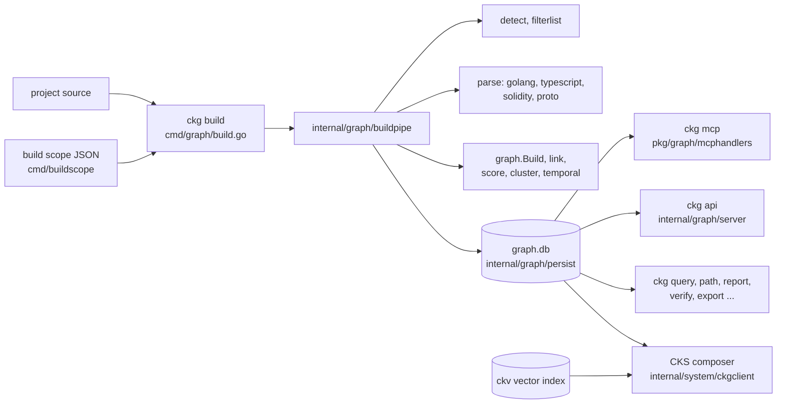
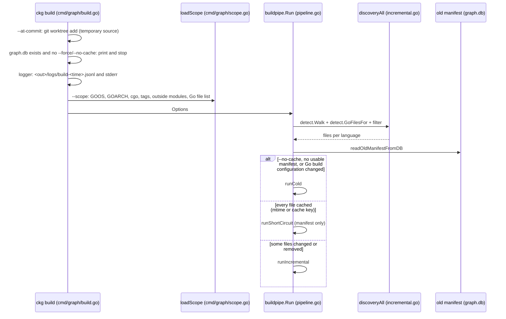
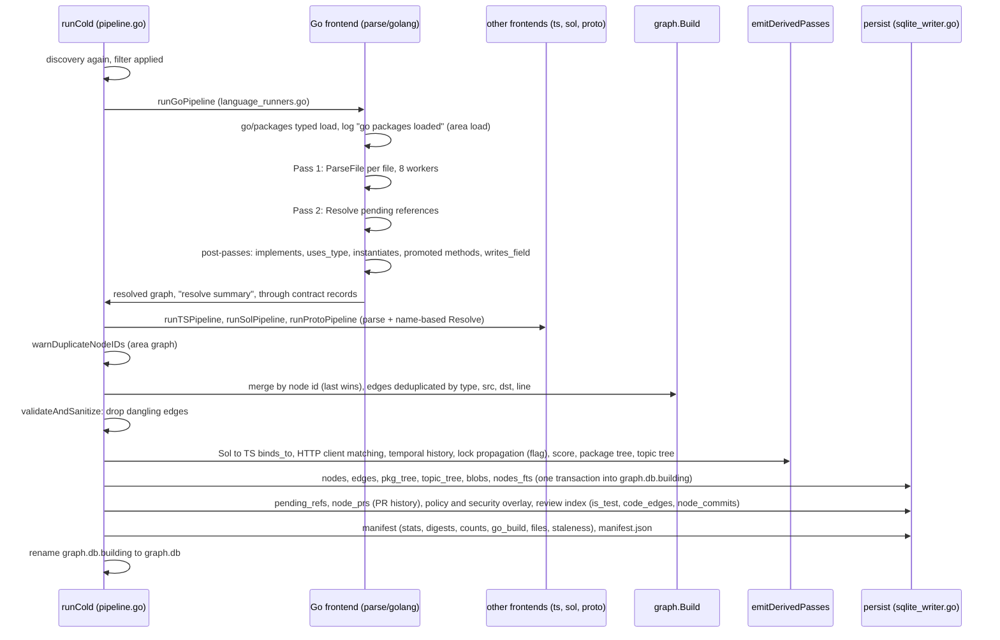
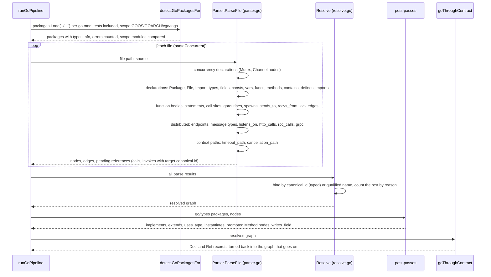
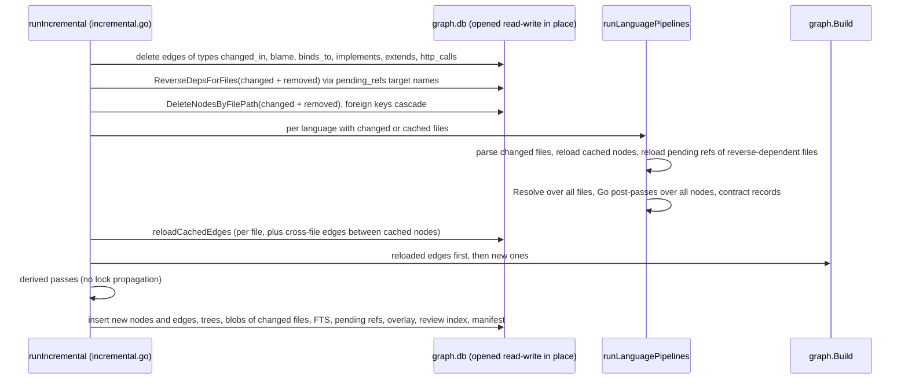
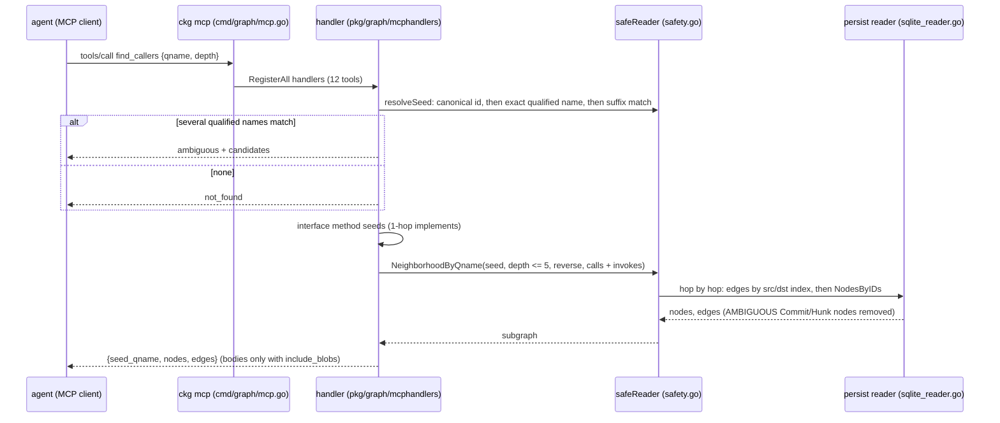
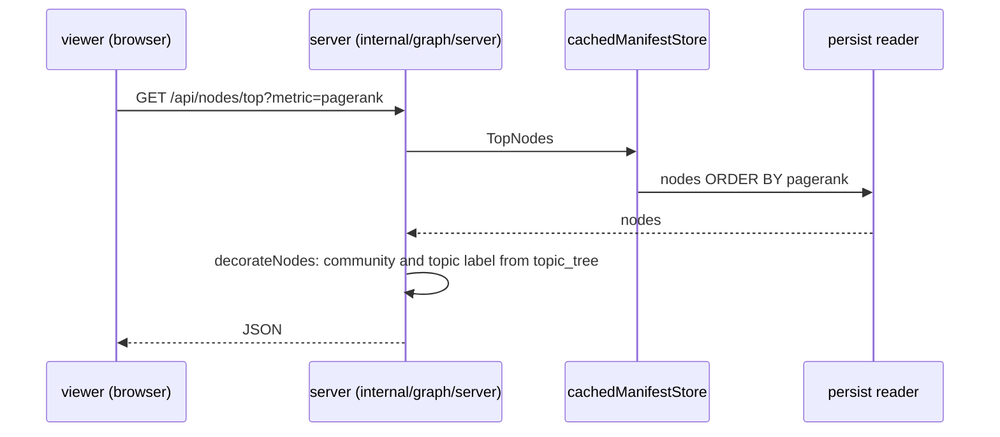
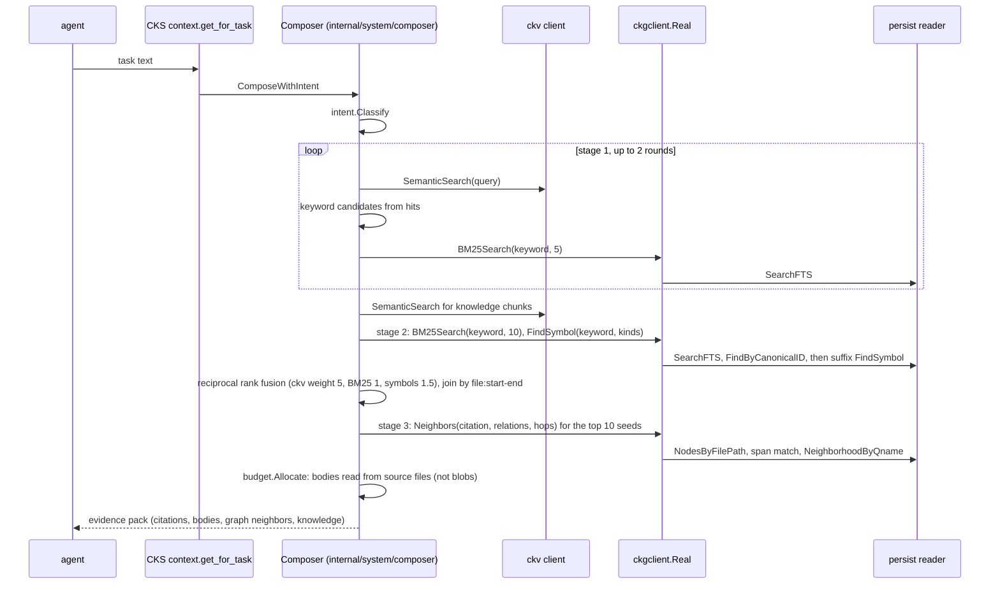

# ckg structure: from project source to graph.db, and every way it is queried

Status: 2026-11-16, code at main 9b8d456d. A map of the code graph engine (ckg) as it is, with sequence diagrams:
how `ckg build` turns a project's source into `graph.db`, what each stored table holds and who writes it, and every
surface that reads the graph (`ckg mcp`, `ckg api`, the CLI, and the CKS search composer). The design the engine
moves to is [the shared symbol contract](./SYMBOL-CONTRACT-DESIGN.md); logging and the short flow summary are in
[the build and query flow](./BUILD-AND-QUERY-FLOW.md). Section 8 lists defects found while mapping; each is marked
as read in the code or inferred.

## 1. Components

Every reader opens the database read-only (`persist.OpenReadOnly`, `mode=ro&immutable=1`); CKS opens it in its own
process through `ckgclient.NewReal`, not over MCP or HTTP.

## 2. Build: entry and cache decision

- A manifest is usable when its schema version equals `SchemaVersion` (`buildpipe/cache.go`, 1.27), the builder
  version equals the ckg version, and it lists files. `DiffManifest` marks a file cached when its mtime and parser
  version are unchanged, or when its cache key (sha256 of content, ckg, parser and schema version) is unchanged.
- `--force` only skips the "graph already exists" check; an unchanged tree still short-circuits.
- The short circuit rewrites the manifest (time, staleness) and leaves every graph table as it was.

## 3. Cold build

### 3.1 The Go frontend

Node ids come from `parse.NodeID(language, file, qualified name, start byte)`; call sites find their enclosing
function by byte span. Resolve binds a typed reference only by its canonical id and counts what it drops
(`outside_graph`, `no_target`, `bare_name`, `no_match`). The TypeScript, Solidity and Proto frontends resolve by name
and count nothing yet.

### 3.2 Derived passes

| Pass | Code | Adds |
|---|---|---|
| Sol to TS link | `link.SolToTS` (`link/xlang.go`) | `binds_to` from a Solidity contract to a TS class of the same name (INFERRED) |
| HTTP client matching | `link.MatchHTTPClients` (`link/http_match.go`) | rewires client endpoint placeholders (AMBIGUOUS) to server endpoints |
| Temporal | `emitTemporalEdges` (`buildpipe/temporal.go`), `temporal/git.go`, `temporal_hunks.go` | Commit and Hunk nodes, `changed_in`, `blame`, `has_hunk`, `adjacent`, `modifies`, patch blobs; capped by `--temporal-depth` (10) and 200 commits for hunks |
| Lock propagation | `propagateLockedFieldAccess` (`lock_propagation.go`), `--lock-propagation`, cold only | `accessed_under_lock` across calls, depth 5 |
| Scores | `score.Compute` (`score/score.go`) | degrees, usage score, PageRank (0.85, 30 iterations, Commit and Hunk excluded) |
| Package tree | `cluster.BuildPkgTree` | directory and package hierarchy |
| Topic tree | `cluster.BuildTopicTree` | Leiden communities at gamma 0.5, 1.0, 2.0 (seed 42), named after the highest-PageRank member |

Each pass that adds edges is followed by `validateAndSanitize`.

## 4. Incremental build

Known differences from a cold build (roadmap D10, measured on go-stablenet): duplicate `uses_type` edges, missing
`extends`, `http_calls`, `implements` and `imports` edges, two cross-file calls missing, scores of cached nodes not
rewritten in the store, no PR history and no lock propagation. Evaluation graphs are built with `--no-cache`.

## 5. Stored tables

| Table | Written by | Holds | Read by |
|---|---|---|---|
| `nodes` | `InsertNodes` (cold, overlay, new nodes on incremental); `RebuildReviewIndex` sets `is_test` | every node: id, type, names, canonical id, file, span, language, signature, doc, scores, confidence, sub kind, attributes, search tokens | every surface |
| `edges` | `InsertEdges` | relations: src, dst, type, file, line, count, confidence, dispatch kind | MCP traversals, impact, concurrency, evidence; HTTP `/api/edges`, impact; CLI query, path, report, verify, exports; CKS neighbors, subgraph, impact, review |
| `nodes_fts` | `RebuildFTS` | FTS5 over name, qualified name, signature, doc, search tokens | MCP `search_text`, `get_context_for_task`; HTTP `/api/search`; CKS BM25 search |
| `blobs` | `InsertBlobs` | source slice per node, gzip patch per Hunk | MCP bodies (`include_blobs`), evidence patches, value flow; HTTP `/api/blob`; exports; CKS value flow, review (not composer bodies) |
| `pending_refs` | `InsertPendingRefs` | Pass-1 references kept for incremental re-resolution | the incremental build only |
| `pkg_tree` | `InsertPkgTree` | package hierarchy | HTTP `/api/hierarchy`, `/api/nodes?parent`; export-static |
| `topic_tree` | `InsertTopicTree` | Leiden communities and labels per resolution | HTTP hierarchy and community labels; report, quickstart, export-static |
| `node_prs` | `InsertNodePRs` (cold only) | pull requests whose merge touched a node | MCP `change_history`, `get_context_for_task` (recent PRs); CKS |
| `code_edges`, `node_commits` | `RebuildReviewIndex` | code relations between production nodes; node to commit | CKS `review_function` only |
| `manifest` | `SetManifest` | build metadata (schema, versions, go_build, digests, counts, files, staleness) | readers' snapshot checks, HTTP `/api/manifest`, report, exports |

## 6. Query surfaces

### 6.1 `ckg mcp` (stdio)

| Tool | Seed | Reads and walk | Limits |
|---|---|---|---|
| `find_symbol` | name (exact by default) | `FindSymbol` | 100 rows, no order |
| `find_callers`, `find_callees` | `resolveSeed` | reverse or forward neighborhood over `calls`, `invokes`; callers add interface method seeds | depth 0 to 5, no node cap |
| `get_subgraph` | `resolveSeed` | forward and reverse walks, all edge types | depth 5, no node cap |
| `search_text` | text | FTS (or substring for non-ASCII) | `top_k` |
| `get_context_for_task` | task text | `smartctx.BuildContext`: search 100, expand hops (frontier 200 per hop), rank 0.5 BM25 + 0.3 PageRank + 0.2 usage, bodies for the top 5, summaries | `budget_tokens` (8000), reports `trimmed` |
| `impact_of_change` | exact qualified name or file | `impact.Compute`: reverse walk, grouped into callers, interface impact, type users, distributed, concurrent, other | depth 1 to 5, no cap |
| `concurrency_impact` | exact qualified name | spawns, sends_to, recvs_from, acquires_lock, accessed_under_lock, both directions | depth 1 to 5, `max_total` |
| `value_dependencies`, `rule_candidates` | node id or canonical id | `valueflow`: blob of one function, CFG and def-use, snapshot pinned by manifest hash | size, block, node, time limits |
| `change_history` | `resolveSeed` | `node_prs` per node | `k` |
| `evidence_for_intent` | intent text, optional seed | all nodes and edges into a hunk corpus with BM25 over commit subjects, patches and modified names | `k`, `budget_tokens` |

### 6.2 `ckg api` (HTTP, loopback only)

Endpoints: `/api/manifest` (with staleness from git), `/api/hierarchy`, `/api/nodes`, `/api/nodes/top`,
`/api/nodes/ambiguous`, `/api/nodes-by-ids`, `/api/edges`, `/api/edges/counts`, `/api/blob/{id}`, `/api/search`
(20 hits), `/api/impact`, `/api/evidence`, `/api/tickets`. Requests with a non-loopback Host header are refused.

### 6.3 CLI

| Command | Reads |
|---|---|
| `ckg query` | all nodes and edges in memory, token scoring, BFS depth 2 from 5 seeds, markdown within `--budget` |
| `ckg path` | all nodes and edges, undirected unweighted BFS, depth 12 |
| `ckg report`, `ckg quickstart` | manifest, nodes, edges, topic tree; quickstart builds first and then serves the API |
| `ckg verify` | nodes and edges by type against go/types truth, with the truth's load errors |
| `ckg validate`, `ckg audit` | nodes and edges; file paths |
| `ckg export-json`, `export-static`, `export-postgres` | everything |
| `ckg evidence` | the evidence pack of section 6.1 |

### 6.4 CKS search composer

The composer joins ckv and ckg results by the citation key `file:start-end`, not by canonical id; ckv hits carry a
canonical id, but the composer uses it only for the ontology boost.

## 7. Planned versus present

| Planned (contract design section 8, flow page section 3) | Present |
|---|---|
| start symbol by exact id, or short name with candidates | `resolveSeed` in four MCP tools; impact, concurrency and evidence take an exact qualified name; CKS returns an error instead of candidates |
| walk filters: edge kind, layer, configuration | edge kind only; no layer or configuration stored (`is_test` read only by review) |
| structure first, bodies on request | mostly; `get_context_for_task` includes bodies by default |
| a token budget on every walk, reporting what was cut | only `get_context_for_task` and evidence; traversals have no node cap or budget |
| in-memory adjacency index, root-cause walk (D14), A* path search (D10) | absent; walks are SQL hop by hop |
| MCP request records with one request id | absent: `ckg mcp` builds a logger and discards it; handlers do not log |

## 8. Defects found while mapping

Read in the code (checked again on main):

1. `resolveSeed` (`pkg/graph/mcphandlers/helpers.go`) turns a canonical id into its qualified name, so every node
   sharing that name becomes a root; its comment says a canonical id traverses one exact node.
2. `ckg mcp` discards the logger it creates (`cmd/graph/mcp.go`), so no MCP request is logged.
3. `ckgclient.Real.Neighbors` reports `Distance: 1` for every neighbor, also for 2-hop results, while stage 3 scores
   by distance.
4. `--force` does not rebuild an unchanged tree; `Options.RebuildMetrics` (`--rebuild-metrics`) is never read.
5. Readers open with `immutable=1`, which assumes the file is replaced by rename; incremental builds and the short
   circuit write `graph.db` in place (risk for `ckg watch` next to a reader; not reproduced).
6. Topic rows are keyed by label (`cluster.TopicTree.ResolutionMembers`), so communities with the same label replace
   each other.

Reported by the mapping, not yet checked again:

7. `FindSymbol` has `LIMIT 100` with no order, so candidate lists over 100 are an arbitrary subset.
8. Stage 1's confidence gate: FTS scores are min-max normalised per result set, so every keyword with a hit scores
   1.0 and the 0.5 gate passes only with two candidates or fewer (inferred).
9. `--at-commit` records the temporary worktree path as `src_root` unless `--logical-src-root` is given.
10. `manifest.ckgignore` is never set; file entries' `edge_ids` are zero after a cold build.
