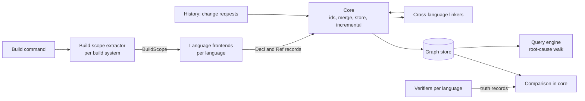

# Shared symbol contract and graph core (design, draft for review)

Status: draft, 2026-11-15. Step 1 of the order of work in the
[graph build design decision](../decisions/20261115-graph-build-design/decision.md) (D5). Nothing here is
implemented yet. Decision IDs (D1-D14) refer to that record; defect IDs from the roadmap are written "roadmap D11".

## 1. Why

The graph has to show which code a build really links together, so that an LLM can walk from a symptom to the root
cause with few tokens (decision goal, D14). Today each language parser builds its own nodes, makes ids from short
names, and resolves references by name in a shared pass. That produced the defects found on 2026-11-13 to 11-15:
packages with the same package name share node ids (roadmap D11), qualified-name lookups mix `main.main` and the
`init` functions of one package, a local type binds to a package-level type (roadmap D12), and the incremental path
dropped the canonical target (roadmap D8). The fixes so far were made language by language and pipeline by pipeline;
`internal/graph/buildpipe` runs eight per-language functions (cold and incremental twins) and node ids are made in two
places (`internal/graph/parse/idgen.go`, `internal/graph/parse/golang/idgen.go`).

This design replaces that with one contract: each language frontend resolves its own code with its own compiler
tools and hands over finished records; the core never resolves names. The design must hold for the languages of D9
(Go, Rust, Python, C, C++, C#, TypeScript, JavaScript, Java, Kotlin, Swift, Solidity, Proto and other IDLs), for
projects whose implementations are swapped per build configuration (D7, D8), and for the server/local split and
limits of D10.

## 2. Layers



| Layer | Owns | Varies by | Decision |
|---|---|---|---|
| Build-scope extractor | which files, targets, flags, link units and outside modules a build command uses, plus their tests | build system | D7, D8, D13 |
| Language frontend | parsing and resolution with the language's compiler tools; optional analyses (Go SSA/VTA, data flow, linker binding) | language | D2, D3 |
| Core | identity, merging configurations, storage, incremental updates, layers, the verifier comparison | nothing | D2, D5 |
| Cross-language linkers | edges across languages (generated code, bindings, endpoints) | language pair | D1 |
| History | change requests as a DAG, derived summaries | version control system | D4 |
| Query engine | traversal, path search, compact answers | nothing | D14 |

The upper layer is one abstraction (D5): the core and the query engine see only the records in section 4.

## 3. Build-scope extractor

A separate tool, possibly a separate repository (D8). Input: the build command or project build settings. Output: one
`BuildScope` document per build configuration.

| Field | Content |
|---|---|
| `config_id` | stable name of the configuration (for example `gstable-linux-amd64`) |
| `toolchains` | per language: name, version the project declares, installed version, checksum, source (D13) |
| `targets` | platform and options (GOOS/GOARCH and tags; Rust target triple and features; C/C++ defines and include paths per file) |
| `entry_points` | main packages, binaries, libraries the configuration produces |
| `files` | path, language, role (`production` or `test`), and for C/C++ the compile command |
| `link_units` | which objects and libraries are linked into each output (C/C++, Rust, Go `//go:linkname` targets) |
| `outside_modules` | modules from outside the repository the build uses: name, version, local path of their source or metadata |

Per build system (first implementations in bold; the rest follow D5 step 9):

| Build system | How the file list is obtained |
|---|---|
| **Go** | `go list -deps -json` with GOOS/GOARCH/tags: `GoFiles`, `CgoFiles`, `SFiles`, `IgnoredGoFiles`, `TestGoFiles`, `XTestGoFiles` |
| CMake, Make, kernel | `compile_commands.json` (CMake option, a build wrapper, the kernel's generator script) plus link commands |
| Cargo | `cargo metadata` plus rustc dependency info per target and feature set |
| MSBuild | the Compile items of each project |
| Maven, Gradle | source sets per module and variant |
| TypeScript | `tsc --listFilesOnly -p <tsconfig>` |
| JavaScript | bundler metafile (esbuild, webpack) or entry points plus import resolution |
| Python | entry points plus import resolution (no build step) |
| Solidity | the framework's compile inputs (foundry, hardhat) or `solc --standard-json` inputs |
| Swift, Kotlin | SwiftPM or Xcode build description; Gradle source sets |

The Go extractor is implemented in `internal/buildscope` with the command `cmd/buildscope` (2026-11-15). On
go-stablenet 6e41d966 for `./cmd/gstable`, linux/amd64, it lists 667 Go and 4 assembly production files in 128
packages, 315 test files, 25 files excluded by build constraints and 94 outside modules; the evaluation graphs of the
same commit hold 1,418 Go files. `crypto/bn256/cloudflare/gfp_generic.go`, `crypto/bn256/google`, `rlp/rlpgen` and
`systemcontracts/compile` are outside this build, so the duplicate declarations and the cross-package edges they
caused do not arise for this configuration.

Test files are listed with the production files they belong to, so the frontends can type-check them, and are marked
`test` for the layer of D6. Files a configuration does not compile never reach a frontend; this removes duplicate
declarations from build tags (for example `gfp_decl.go` and `gfp_generic.go` in `crypto/bn256/cloudflare`).

## 4. The contract: records a frontend emits

### 4.1 Identity

A symbol id is a string the frontend builds from compiler-resolved facts; the node id is a hash of it, made in one
place in the core.

```
symbol_id = <language> ":" <module identity> ":" <symbol path> [ "@" <file> ":" <declaration offset> ]
```

- **Module identity** is what the language uses to tell modules apart. It is never the short package name.
- **Symbol path** is the path inside the module: type, member, receiver, signature parts the language needs to tell
  overloads apart.
- **The location suffix** is added only where the language allows two declarations with the same path: several `init`
  functions in one Go package, declarations local to a function or block, file-local (static) C functions.

| Language | Module identity | Notes |
|---|---|---|
| Go | import path | methods carry the receiver (`(*T).M`); generic instances map to their origin |
| Rust | crate name, module path (version only for crates outside the repository) | trait impls carry the implementing type and trait |
| Python | dotted module path from the package root | dynamic attributes are not symbols |
| C | link name for external linkage; translation unit plus name for internal (`static`) linkage | ties into `link_units`; two external definitions of one link name are reported, not merged |
| C++ | mangled name for external linkage; translation unit plus mangled name for internal linkage and anonymous namespaces | overloads and template specializations differ by the mangled name |
| C# | assembly and namespace | overloads differ by signature |
| Java, Kotlin | package and class path | overloads differ by signature |
| TypeScript, JavaScript | module file path relative to the project, export name | default exports named `default` |
| Swift | module name | extensions carry the extended type |
| Solidity | source unit path and contract | inheritance order per C3 linearization |
| Proto and IDLs | package and file | messages and services |

Module identities carry no version for code inside the repository, so that a symbol keeps its id across snapshots
and the history of section 7 can follow it. Code outside the repository keeps its version, because two versions of
one outside module are different code.

Today's `canonical_id` (`docs/graph/SCHEMA.md`) is the Go form of this id without the language prefix. The vector
store joins on `canonical_id` only (`docs/vector/SCHEMA.md`), so the join keeps working if the core keeps writing
`canonical_id` as the language-specific part of the symbol id.

### 4.2 Scope and lifetime of local declarations

A local declaration gets the id of its enclosing symbol plus the location suffix. Every reference carries the id the
compiler tool resolved it to (in Go, `types.Info.Uses`), so a local `type pair` can never bind to a package-level
`pair` (roadmap D12). Values whose lifetime leaves the function (captured by a closure or goroutine, sent on a
channel, stored in a field, returned by pointer) are reported through the data-flow capability (section 5), not as
plain references.

### 4.3 Records

| Record | Fields |
|---|---|
| `Decl` | symbol id, kind (common kind plus language subkind), name, file, span, layer, signature, doc text, visibility |
| `Ref` | from symbol id, to symbol id, edge kind, site (file, span), confidence, analysis that produced it |
| `Unresolved` | from symbol id, the written target, site, reason (outside the build, dynamic, tool error) |
| `Note` | free attributes a frontend wants to keep (for example Solidity storage slots) |

Common declaration kinds: module, type, interface (interface, trait, protocol), callable (function, method,
constructor), field, variable, constant, and the IDL kinds message and service. A frontend may add subkinds; the core
and the query engine use the common kind.

Edge kinds, grouped:

| Group | Kinds |
|---|---|
| Structure | `contains`, `defines`, `imports` |
| Calls | `calls` (static callee), `invokes` (call through an interface method), `dispatches_to` (interface method to an implementation that can reach it), `overrides` |
| Types | `uses_type`, `instantiates`, `implements`, `extends` |
| Data | `reads`, `writes` (fields and package-level values), `flows_to` (a value from one site reaches another) |
| Concurrency | `spawns` (to the callable the goroutine or thread runs), `sends_to`, `recvs_from` (to a channel identified by the variable or field that holds it) |
| Linking | `links_to` (a reference bound by the linker: external symbols, `//go:linkname`, weak symbols), `registers` (an implementation registered under a name at run time, for example `directory.Register` in `eth/tracers`) |
| Errors | `propagates_error` (a callee's error that the caller returns or wraps), used by the root-cause walk |
| Cross-language | `generated_from`, `binds_to`, `serves`, `requests` |
| History | `changed_by`, `parent` (section 7) |

Confidence: `certain` (compiler or linker resolved it), `static_may` (an analysis estimates it can happen, for example
VTA), `observed` (seen in a test run trace), `unresolved` is a separate record, not an edge. Unresolved references
are kept so that recall gaps can be counted instead of disappearing.

### 4.4 Layers and configurations

Every `Decl` has a layer: `production`, `test`, `outside` (declarations of outside modules, D8) or `history`. Every
`Decl` and `Ref` carries the set of configurations it occurs in. The core merges the outputs of all configurations:
one node per symbol id with the union of configurations; a reference that exists only in some configurations keeps
only those. Search defaults to production and the configuration the caller names (D6); tests come back in a separate
`related_tests` slot or when asked for.

## 5. Language frontend interface

```go
// Sketch, names not final.
type Frontend interface {
    Language() string
    // Load type-checks the files of one configuration with the project's toolchain (D13).
    Load(ctx context.Context, scope BuildScope, config string) (Unit, error)
}

type Unit interface {
    Decls() iter.Seq[Decl]
    Refs() iter.Seq[Ref]
    Unresolved() iter.Seq[Unresolved]
    // Dependencies lists, per file, the files whose change can change this file's records;
    // the core uses it for incremental invalidation.
    Dependencies() map[string][]string
}

// Optional capabilities; a frontend implements the ones it can.
type RuntimeLinks interface{ DispatchAndSpawn(Unit) iter.Seq[Ref] } // Go: SSA + VTA (D3)
type DataFlow interface{ Flows(Unit) iter.Seq[Ref] }                 // reads, writes, flows_to
type LinkerBinding interface{ Links(Unit, []LinkUnit) iter.Seq[Ref] } // C, C++, Rust, Go linkname
```

Rules:

- A frontend resolves everything it emits. The core never matches names; a reference the tool cannot resolve is an
  `Unresolved` record.
- A frontend reads only the files of the scope it is given.
- Analyses such as SSA stay inside the frontend that needs them; their output is ordinary `Ref` records with
  `static_may` confidence.
- Frontends run as separate processes where the tool requires it (tsc, Roslyn, clang) and exchange records in a
  versioned format; the Go frontend can run in process.

## 6. Core

- **Identity:** one function hashes symbol ids to node ids. No other place makes ids.
- **Merging:** records from several configurations and languages are merged by symbol id (section 4.4).
- **Storage:** today's tables gain the symbol id, layer and configuration set; `qualified_name` stays a display field.
- **Incremental builds:** a changed file invalidates its own records and those of the files that depend on it, by the
  frontend's `Dependencies`. The cold and incremental paths share one code path; the D11 criterion "incremental equals
  cold" is checked by building both and comparing.
- **Cross-language linkers:** small modules per language pair that read records of both sides and emit cross-language
  references, for example Go code generated from a `.proto` file, Go abigen bindings of a Solidity contract,
  TypeScript clients of HTTP and gRPC endpoints.
- **Verification:** each language has a verifier that computes truth records from a compiler tool independently of
  the frontend; the core compares truth and graph records with the rules of `internal/graph/verify` (missing versus
  misresolved, no false flags on correct edges), now for every language.

## 7. History (D4)

| Record | Fields |
|---|---|
| change request node | id (commit hash, PR number), time, author role, intent text, intent source (`message`, `pr`, `inferred`) |
| `parent` edge | change request to its parent change requests, so the history is a DAG like git's |
| `changed_by` edge | declaration (by symbol id) to the change request, with the span before and after |
| derived summary | per declaration, computed from the DAG: recent intents and the change requests that touched it |

Declarations are linked by symbol id, so the history follows a symbol across snapshots. Links are kept at declaration
level; the statement-level `changed_in` edges of today (1.62 million on go-stablenet) are replaced (D12). PR and
commit text stays in the vector store for text search, linked by change-request id. Evaluation builds cut the history
at the base commit of each case, as today.

## 8. Query engine (D14)

The query engine works on an in-memory adjacency index per layer and configuration, loaded from the store.

- **Walk:** from a symbol, follow callers or callees, readers or writers, hop by hop, with filters on edge kind, layer
  and configuration. Returns structure first: symbol ids, names, spans, edge kinds, confidence, no bodies.
- **Expand:** the LLM asks for more around a node (another hop, a body, the history of a declaration) through a tool.
- **Budget:** every walk takes a token budget and stops when the structure it would return exceeds it; the answer says
  what was cut so the LLM can ask for it.
- **Root-cause walk:** from the symptom symbol, walk callers upstream and data flow (writers of the values the symptom
  reads), ranked by an edge cost that makes data writes and error propagation cheap and unrelated calls expensive.
- **Path search:** A* with landmark distances (ALT) over non-negative edge costs; landmarks are chosen and their
  distances computed when the server builds the graph (D10). Dijkstra and A* are best-first searches, not
  depth-first; A* is faster only with an admissible heuristic, which landmark distances give on any graph.
- **Judgment:** tokens used and correctness of the fix point on cases with known fixes (D11, D14).

## 9. Migration from the current code

| Today | After |
|---|---|
| `internal/graph/parse/parser.go` `Parser` (ParseFile, Resolve) | `Frontend` and `Unit`; Resolve by name is removed |
| `MakeID` in two places | one id function in the core |
| eight pipeline functions in `internal/graph/buildpipe` | one path for cold and incremental builds |
| `pending_refs` with names and canonical targets | `Unresolved` records and frontend dependencies |
| `internal/graph/filterlist` (`--files-from-main`, directory globs) | the build-scope extractor (file level) |
| `internal/graph/verify` (Go only) | the comparison in the core plus one verifier per language |
| CKS graph client calls keyed by short names (`internal/system/ckgclient`) | calls keyed by symbol id; short names only for the first lookup |

Reused: the Go parser's go/types analyses (calls, uses_type, implements, concurrency), the Solidity and Proto
frontends' declaration code, the verifier's comparison rules, the store's tables. Order and gates follow D5 and D11:
the Go frontend is moved first and must meet the D11 numbers on the go-stablenet base commits before the next step.

## 10. Open points and proposed defaults

| Point | Proposed default | Why | Settled when |
|---|---|---|---|
| Where the build-scope extractor lives | its own Go package and command in this repository, importing nothing from the graph engine, with a versioned JSON output; moved to its own repository when another project needs it | one CI and release while the format settles; no imports keeps the move cheap | now (step 2) |
| Record exchange with out-of-process frontends | JSON Lines with a schema version per record stream | readable, streamable, enough for the first frontends; a binary format only if measurements show the exchange limits D10 | step 8 (first out-of-process frontend) |
| Deployment target of go-stablenet | linux/amd64, default tags, entry point `cmd/gstable` | the production node binary; all owning functions of the 11 cases lie in that closure | **to be confirmed by the user** before it is used for a judgment |
| Edge costs of the root-cause walk | fixed per edge kind and confidence, written down before the first measurement | D11 fixes criteria before measuring | step 6 (data flow) |
| Fields of the derived history summary, intent when a commit has no message | recent intents with their source, and an intent inferred from the diff marked `inferred` | D4 asks for a source plus a derived view | step 7 (history) |

## 11. How the decisions map to this design

| Decision | Section |
|---|---|
| D1 verifier per language and cross-language metrics | 6 (verification, cross-language linkers) |
| D2 shared contract and frontends | 4, 5 |
| D3 SSA/VTA inside the Go frontend, separate build-file extraction | 3, 5 |
| D4 change-request DAG and derived summaries | 7 |
| D5 order of work and one upper abstraction | 2, 9 |
| D6 test layer | 4.4 |
| D7, D8 build-command files, configurations, outside declarations | 3, 4.4 |
| D9 languages | 3, 4.1 |
| D10 server and local | 6 (incremental), 8 (landmarks on the server) |
| D11 criteria | 6, 9 |
| D12 what stays | 7, 9 |
| D13 toolchains | 3 |
| D14 queries | 8 |
