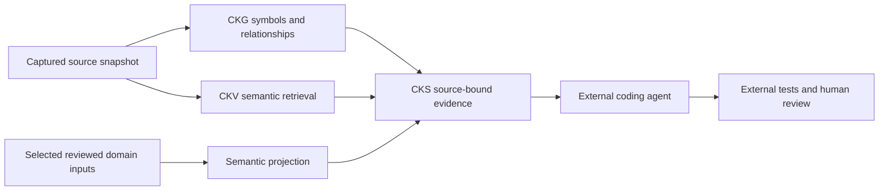

# Product context and responsibility map

The current repository consolidates graph, vector and composition engines. Project inputs remain owned by their packs. [Architecture](../../docs/ARCHITECTURE.md) describes the implementation; [purpose and scope](../../docs/spec-driven/PURPOSE-AND-SCOPE.md) describes original requirements and external responsibilities.

CKS readiness validates configured/pinned data; it does not certify business truth. Meaning lookup and requirement trace may be available with ontology retrieval off. Code-symbol links, exact test execution and criterion decisions have distinct ownership. Missing paths and unreviewed relations remain visible.

The coding-agent reasoning workflow, ChainBench oracle validation, candidate selection and learning services belong to separate repositories. This document does not claim their latest versions, completion or remote host state. The reference project pack is an example, not the identity of this general-purpose product. Read its own source revision/inventory before using domain facts.

[Evaluation limits](../../docs/spec-driven/EVALUATION-STATUS.md), [release policy](../../docs/spec-driven/RELEASE-POLICY.md) and [remaining work](../../docs/REMAINING-WORK.md) replace old machine-specific counters and dated remaining-work claims.
