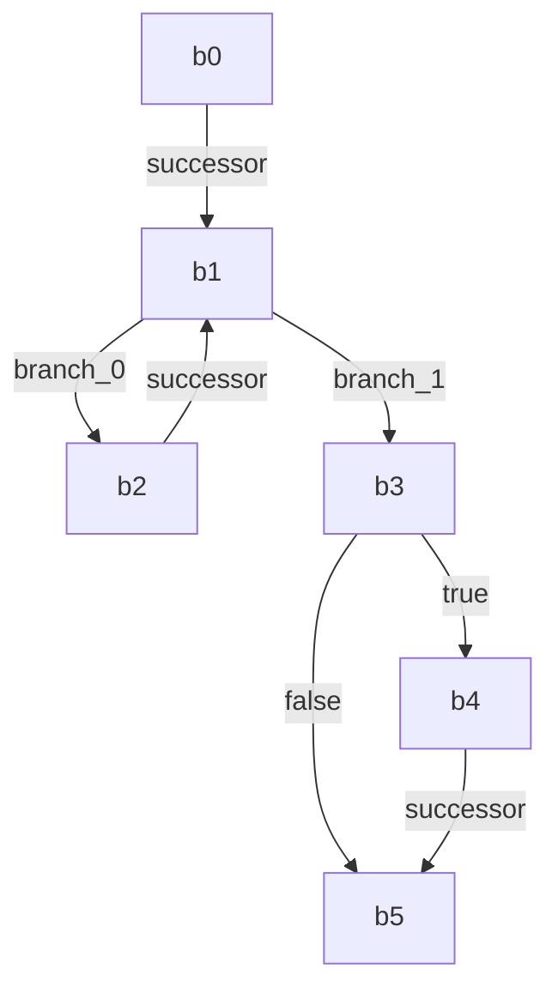

# Structured function review

Status: structured partial review; independent acceptance: not recorded.

Source pins:
```json
{
  "bytes": 241,
  "canonical_id": "example.invalid/deep-fixture.Process",
  "commit": "0e9d9ef667cf2d4d5780c15a29ea7b53da1d5baa",
  "file": "logic.go",
  "function_name": "Process",
  "language": "go",
  "node_id": "c7b299f57164a5df",
  "sha256": "2debeb905228667208557e416dafb9f64fc596b441b29b7e90a86e901bcbf96b",
  "snapshot_sha256": "7dc9121b95d68404d3dbdfb106a76486c56c2a79c7a4d939d2b0ee0c8ae15ade",
  "start_byte": 158,
  "start_line": 12
}
```

Computed CFG sequence (not an execution trace):
```json
{
  "edges": [
    {
      "certainty": "structural",
      "from": "b0",
      "kind": "cfg",
      "to": "b1"
    },
    {
      "certainty": "conservative",
      "condition": "branch_0",
      "from": "b1",
      "kind": "cfg",
      "to": "b2"
    },
    {
      "certainty": "conservative",
      "condition": "branch_1",
      "from": "b1",
      "kind": "cfg",
      "to": "b3"
    },
    {
      "certainty": "structural",
      "from": "b2",
      "kind": "cfg",
      "to": "b1"
    },
    {
      "certainty": "conservative",
      "condition": "true",
      "from": "b3",
      "kind": "cfg",
      "to": "b4"
    },
    {
      "certainty": "conservative",
      "condition": "false",
      "from": "b3",
      "kind": "cfg",
      "to": "b5"
    },
    {
      "certainty": "structural",
      "from": "b4",
      "kind": "cfg",
      "to": "b5"
    }
  ],
  "kind": "bounded_cfg_not_execution_trace"
}
```

Module membership:
```json
{
  "file": "logic.go",
  "interprocedural_edges": "unknown",
  "kind": "retained_file_membership",
  "symbol": "c7b299f57164a5df"
}
```

## data_state

```json
{
  "assumptions": [
    "Box has the fixture Total field"
  ],
  "claim": "The retained syntax writes the accumulated total into box.Total",
  "evidence_nodes": [
    "b3/n0"
  ],
  "origin": "agent_reasoning",
  "status": "inferred",
  "unknowns": [
    "Memory/alias/concurrent effect and range value dependencies are not proven by the graph"
  ]
}
```

## guards_exceptions

```json
{
  "assumptions": [
    "Fixture strict flag is intended to control the negative-total guard"
  ],
  "claim": "Strict negative totals replace the command, while other paths may retain the parameter",
  "evidence_nodes": [
    "b5/n0"
  ],
  "origin": "agent_reasoning",
  "status": "inferred",
  "unknowns": [
    "Local rule paths do not prove all caller authorization, target resolution or exception behavior"
  ]
}
```

## complexity

```json
{
  "assumptions": [
    "Each range iteration has bounded integer addition; all arithmetic cost assumptions are local"
  ],
  "claim": "The source loop suggests O(len(values)) local traversal excluding external construction work",
  "evidence_nodes": [
    "b0/n1"
  ],
  "origin": "agent_reasoning",
  "status": "inferred",
  "unknowns": [
    "Range binding/value semantics and external API complexity are not proven or measured"
  ]
}
```

## resources

```json
{
  "assumptions": [
    "Only the source local storage is assessed"
  ],
  "claim": "The local total has bounded scalar storage; resource cost of the constructed command is not established",
  "evidence_nodes": [
    "b3/n0",
    "b5/n0"
  ],
  "origin": "agent_reasoning",
  "status": "inferred",
  "unknowns": [
    "Input ownership, external allocations and memory use have no runtime measurements"
  ]
}
```

## io

```json
{
  "assumptions": [
    "This selector refers to the intended standard library API"
  ],
  "claim": "The source constructs a command; process execution is outside this function view",
  "evidence_nodes": [
    "b5/n0"
  ],
  "origin": "agent_reasoning",
  "status": "inferred",
  "unknowns": [
    "Target/import resolution and command lookup/environment I/O are unverified"
  ]
}
```

## priority_tradeoffs

```json
{
  "assumptions": [
    "Review goal prioritizes stable behavior and controlled state changes"
  ],
  "claim": "Prioritize intended command-name restrictions and state ownership before loop optimization; stricter guards can reduce compatibility",
  "evidence_nodes": [
    "b3/n0",
    "b5/n0"
  ],
  "origin": "agent_reasoning",
  "status": "inferred",
  "unknowns": [
    "Caller requirements, threat context and measured throughput are unavailable"
  ]
}
```

## Findings and review criteria

```json
{
  "criteria": [
    {
      "id": "data_state",
      "reason": "Scoped original-node evidence and explicit assumptions supplied; independent acceptance not recorded",
      "requirement": "Review data_state",
      "section": "data_state",
      "status": "covered"
    },
    {
      "id": "guards_exceptions",
      "reason": "Scoped original-node evidence and explicit assumptions supplied; independent acceptance not recorded",
      "requirement": "Review guards_exceptions",
      "section": "guards_exceptions",
      "status": "covered"
    },
    {
      "id": "complexity",
      "reason": "Scoped original-node evidence and explicit assumptions supplied; independent acceptance not recorded",
      "requirement": "Review complexity",
      "section": "complexity",
      "status": "covered"
    },
    {
      "id": "resources",
      "reason": "Scoped original-node evidence and explicit assumptions supplied; independent acceptance not recorded",
      "requirement": "Review resources",
      "section": "resources",
      "status": "covered"
    },
    {
      "id": "io",
      "reason": "Scoped original-node evidence and explicit assumptions supplied; independent acceptance not recorded",
      "requirement": "Review io",
      "section": "io",
      "status": "covered"
    },
    {
      "id": "priority_tradeoffs",
      "reason": "Scoped original-node evidence and explicit assumptions supplied; independent acceptance not recorded",
      "requirement": "Review priority_tradeoffs",
      "section": "priority_tradeoffs",
      "status": "covered"
    }
  ],
  "findings": [
    {
      "assumptions": [
        "Command selection is a review concern in the fixture"
      ],
      "category": "guard",
      "claim": "Review the unrestricted command-name path under the intended caller policy",
      "evidence_nodes": [
        "b5/n0"
      ],
      "id": "guard-scope",
      "origin": "agent_reasoning",
      "priority": "high",
      "rule_candidates": [
        "0749b9f2ec8a0e8478204936112e2759c30617931c2a653f41c2ceccd0a56860"
      ],
      "state": "review_candidate",
      "suggestion": "Clarify allowed commands and strict=false callers before changing the guard",
      "unknowns": [
        "No exploit or whole-program access-control gap is established"
      ]
    },
    {
      "assumptions": [
        "State stability is more important than unmeasured speed"
      ],
      "category": "tradeoff",
      "claim": "State ownership/guard correctness should be reviewed before optimizing the accumulation loop",
      "evidence_nodes": [
        "b3/n0",
        "b0/n1"
      ],
      "id": "state-priority",
      "origin": "agent_reasoning",
      "priority": "medium",
      "rule_candidates": [],
      "state": "review_candidate",
      "suggestion": "Document ownership and compatibility conditions, then measure external costs separately",
      "unknowns": [
        "No production concurrency contract or benchmark supplied"
      ]
    }
  ]
}
```

## Limitations

- graph rule/value computation is bounded, not whole-program safety
- structural review lacks its own immutable snapshot/blob pin; no atomic cross-call proof
- source/CFG order is not a runtime call trace
- agent findings, complexity/resources/I/O and priorities are reasoning, not measured facts
- local receipt hashes do not authenticate MCP transport or grant reviewer acceptance

## Diagrams (computed local structure; no runtime trace)




